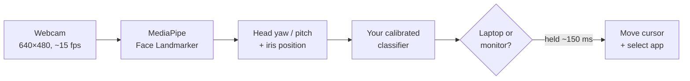

<div align="center">


# LookHop

**Your cursor follows your eyes between your laptop and your monitor.**

Look at the other screen and the cursor and the app you were using there come with you.
No dragging the mouse across two screens, no extra click to select the window.

[](https://github.com/shubhendam/LookHop/releases/latest)


<br>


<sub>The live view while I turn between my laptop (left) and monitor (right). The full clip is in <a href="assets/demo.mp4"><code>assets/demo.mp4</code></a>.</sub>

</div>

---

## Why

With a laptop beside an external monitor, you spend the day sliding the mouse back and forth across two screens and clicking to select windows.
LookHop uses the webcam you already have to see **which screen you're facing**, then moves the cursor there and selects the app you were last using on that screen.

## Features

| | |
|---|---|
| 👀 **Head + eye tracking** | Head angle does most of the work; iris position is a backup signal. Tuned for the classic "laptop + monitor beside it" setup. |
| ⚡ **Instant or on mouse move** | Jump the moment you look, or only when you reach for the mouse. |
| 🪟 **Selects the app too** | Brings the app on top of that screen to the front, like Alt+Tab but per screen. |
| ⌨️ **Typing guard** | A glance while you're typing never sends your keystrokes to the wrong window. |
| 🎯 **Lands where you left off** | The cursor returns to where it last was on that screen (or the centre, if you prefer). |
| 🧭 **One-minute calibration** | Follow a dot between your screens; you get an honest accuracy score at the end. |
| 👓 **Glasses mode** | A separate calibration that trusts head pose more than the eyes. |
| 🎛️ **Control panel** | Live view of what it sees, plus every setting, applied instantly. |
| 🪶 **Light** | ~15 frames/s at ~15 ms each on a laptop CPU. The camera turns off while paused. |
| 🔒 **Private** | Everything runs on your machine. No account, no network, no telemetry. |

## Quick start (macOS)

1. Download **`LookHop-x.y.z-macos-arm64.zip`** from [**Releases**](https://github.com/shubhendam/LookHop/releases/latest), unzip it and drag **LookHop.app** to *Applications*.
2. The build isn't notarized yet, so macOS blocks the first launch: **right-click LookHop.app → Open → Open** (or *System Settings → Privacy & Security → Open Anyway*).
3. Allow **Camera** when asked, then grant **Accessibility** (see below). Restart LookHop after granting Accessibility.
4. **Calibrate** (about 45 s), as described in the Windows steps below. LookHop lives in the **menu bar** (the eye icon); click it for the menu or *Open control panel*.

| Permission | Why | Where |
|---|---|---|
| **Camera** | see where you look (frames never leave your Mac) | System Settings → Privacy & Security → Camera |
| **Accessibility** | bring the other screen's app to the front, and the pause hotkey (**Ctrl + Option + G**) | System Settings → Privacy & Security → Accessibility |
| **Notifications** (optional) | short status messages, e.g. when you pause | System Settings → Notifications → LookHop |

> The app is ad-hoc signed, so macOS may ask you to grant the permissions again after you install an update (remove the old *LookHop* entry and add it again if the switch looks on but nothing works). Running from source? The permissions belong to the terminal you start it from.
>
> The Mac's **built-in display** is treated as the laptop and the other display as your monitor. If that's the wrong way round, change *Laptop display* (System tab).

## Quick start (Windows)

1. Download **`LookHop-x.y.z-windows-x64.zip`** from [**Releases**](https://github.com/shubhendam/LookHop/releases/latest) and unzip it anywhere.
2. Run **`LookHop.exe`**.
   > Windows SmartScreen may warn about an unrecognised app, because the build isn't code-signed yet. Click **More info → Run anyway**.
3. **Calibrate** (about 45 s): a dot jumps between your laptop and monitor. Look at each one the way you naturally would, turning your head as usual, then press **Enter** to save.
4. That's it. LookHop now lives in the **system tray** (the eye icon, which may be under the **^** arrow).

| To… | Do this |
|---|---|
| Open the control panel | Left-click the tray icon |
| Pause / resume (camera off) | **Ctrl + Alt + G** (macOS: **Ctrl + Option + G**), or the tray menu |
| Recalibrate | Control panel → Behaviour → *Recalibrate…* |
| Start automatically at login | Control panel → System → *Start with Windows* |
| Quit | Right-click the tray icon → *Quit* |

## How it works



- **Calibration** records head angle and iris position while you look at dots on each screen, then trains a small logistic regression (head = main vote, iris = backup). Accuracy is measured on dots the model never saw.
- **The monitor is "home".** Switching to the laptop needs high confidence held for a moment; switching back needs less. If the camera loses your face (you've turned away from it), you're on the monitor.
- **One jump per glance.** If you drag the cursor back by hand, LookHop leaves it alone until your gaze changes again. It never jumps while a mouse button is held.

## Privacy

- Camera frames are processed **in memory, on your machine**, and never saved or sent anywhere.
- The release build makes **no network requests**: the face model ships inside it.
- Your data lives in `%APPDATA%\LookHop`: `config.json` (settings), `calibration*.json` (a few numbers describing your head/eye positions), and a log. Delete the folder to reset everything.

## Platform support

| OS | Status |
|---|---|
| **Windows 10 / 11** | ✅ Supported |
| **macOS 11+** | ✅ Supported (Apple silicon tested; see [`lookhop/platform/macos`](lookhop/platform/macos/__init__.py)) |
| **Linux (X11)** | 🛠️ Help wanted: see [`lookhop/platform/linux`](lookhop/platform/linux/__init__.py) |
| **Linux (Wayland)** | ⚠️ Compositors block moving the pointer and switching windows from apps; needs per-compositor work |

The Linux stub lists exactly which functions to implement and which system APIs to use. See [CONTRIBUTING.md](CONTRIBUTING.md).

## Run from source

```powershell
git clone https://github.com/shubhendam/LookHop.git
cd LookHop
python -m venv .venv
.\.venv\Scripts\python.exe -m pip install -r requirements.txt
.\.venv\Scripts\python.exe -m lookhop            # or double-click run.bat
```

On macOS (python.org Python recommended; with Homebrew install `python-tk` too):

```bash
git clone https://github.com/shubhendam/LookHop.git
cd LookHop
python3 -m venv .venv
.venv/bin/python -m pip install -r requirements.txt
.venv/bin/python -m lookhop
```

Build the macOS app yourself (PyInstaller, then a built-in selftest, then a zip in `dist/`): `./packaging/macos/build.sh`

Build the Windows release yourself (PyInstaller, then a built-in selftest, then a zip in `dist/`):

```powershell
powershell -ExecutionPolicy Bypass -File packaging\windows\build.ps1
```

<details>
<summary><b>All settings</b> (control panel, or <code>%APPDATA%\LookHop\config.json</code>; on macOS <code>~/Library/Application Support/LookHop/config.json</code>)</summary>

| Key | Default | Meaning |
|---|---|---|
| `mode` | `instant` | `instant` (jump when you look) or `mouse_move` (jump when you then move the mouse) |
| `focus_window` | `true` | Bring the top app on the target screen to the front after a jump |
| `typing_guard` / `typing_guard_ms` | `true` / 600 | Instant mode: wait until you stop typing this long before jumping |
| `warp_to` | `last` | `last` (where the cursor last was on that screen) or `center` |
| `quick_jump` / `quick_jump_prob` | `true` / 0.85 | Mouse mode: skip the hold time when one frame is this confident as you grab the mouse |
| `glasses` | `false` | Use the glasses profile and lower iris weight |
| `hotkey` | `ctrl+alt+g` | Pause/resume hotkey, e.g. `win+shift+f9` |
| `laptop_display` | `left` (macOS: `builtin`) | `left`, `right`, `primary`, `builtin` (the computer's own display, macOS), or a device name like `\\.\DISPLAY1` |
| `fps` / `idle_fps` | 15 / 5 | Analysis rate with / without a face in view |
| `laptop_enter_prob` / `laptop_exit_prob` | 0.70 / 0.35 | Switching thresholds (hysteresis) |
| `laptop_dwell_ms` / `monitor_dwell_ms` | 150 / 200 | How long a look must hold before it counts |
| `no_face_to_monitor_ms` | 500 | Face lost this long means monitor |
| `move_start_gap_ms` | 150 | Mouse mode: mouse must be still this long before a move counts as reaching for it |
| `iris_weight` / `iris_weight_glasses` | 0.5 / 0.2 | Iris vote relative to head pose |
| `camera_index` | 0 | Which webcam to use |
| `calibration_rounds` | 2 | Rounds of 10 dots |

</details>

<details>
<summary><b>Troubleshooting</b></summary>

- **Jumps on a quick glance:** raise *Hold before laptop* (Tuning tab).
- **Feels slow:** lower the hold times or raise *Analysis rate*; the live view shows the real fps and ms/frame.
- **Tray icon is amber / "Camera unavailable":** another app (Teams, Zoom) is using the webcam. LookHop retries every few seconds, or press Ctrl+Alt+G (Ctrl+Option+G on macOS) to pause it during calls.
- **Accuracy dropped:** recalibrate after moving the monitor, changing seats or changing lighting.
- **Wrong screen treated as the laptop:** System tab → *Laptop display*.
- **Logs:** `%APPDATA%\LookHop\lookhop.log`, or `~/Library/Application Support/LookHop/lookhop.log` on macOS (System tab → *Open log*).
- **macOS: cursor jumps but the app doesn't come to the front / the hotkey does nothing:** LookHop is missing the Accessibility permission (see Quick start).
- **macOS: "Camera unavailable":** check *Privacy & Security → Camera*, and that no other app is using the webcam.

</details>

## Contributing

A **Linux** port is the most wanted contribution. Bug reports, tuning ideas and setups other than laptop + monitor are welcome too.
Start with [CONTRIBUTING.md](CONTRIBUTING.md).

## License

[MIT](LICENSE). Face tracking by Google's [MediaPipe](https://ai.google.dev/edge/mediapipe) Face Landmarker (Apache 2.0).
